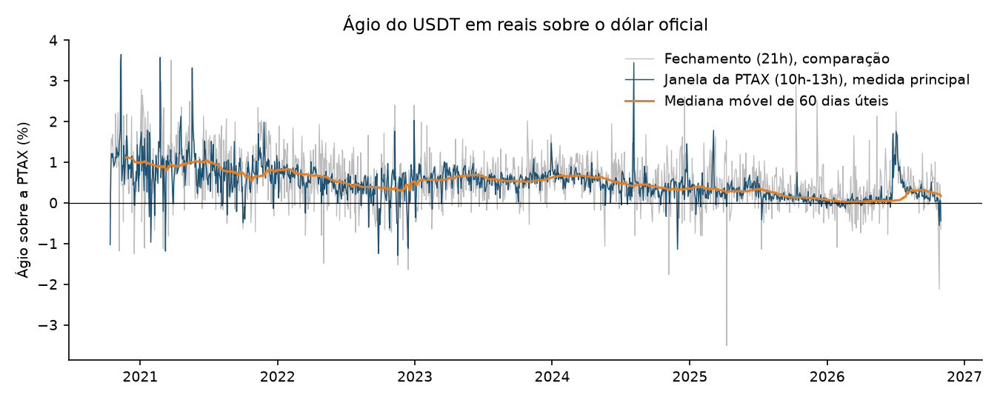
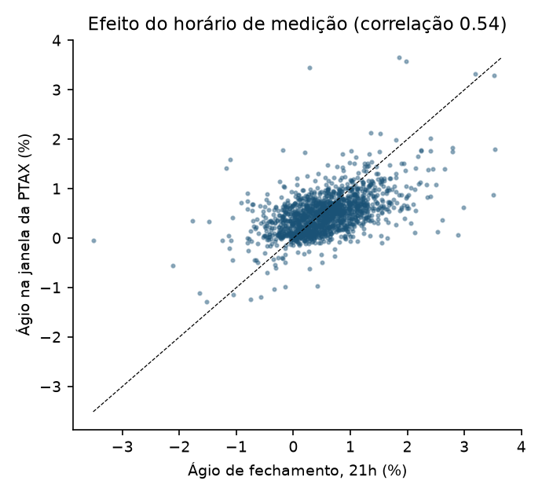
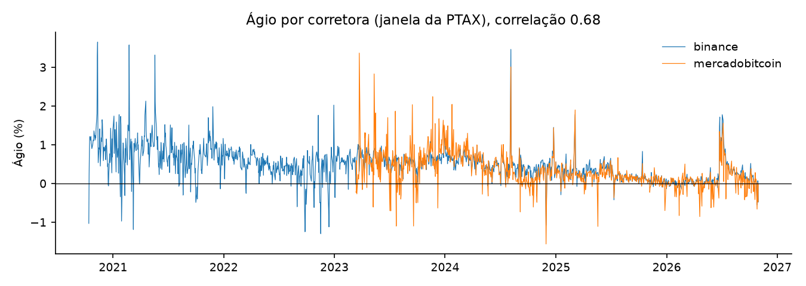
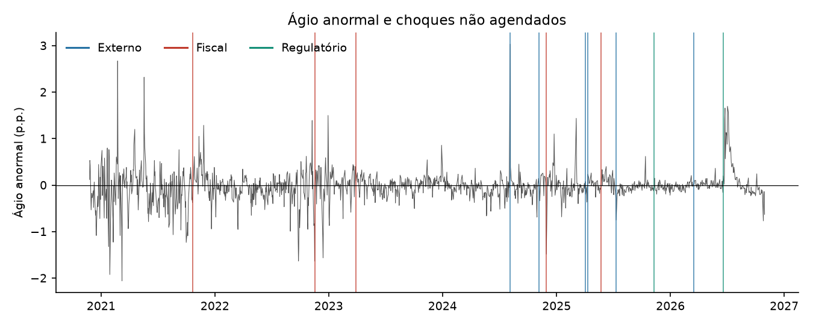
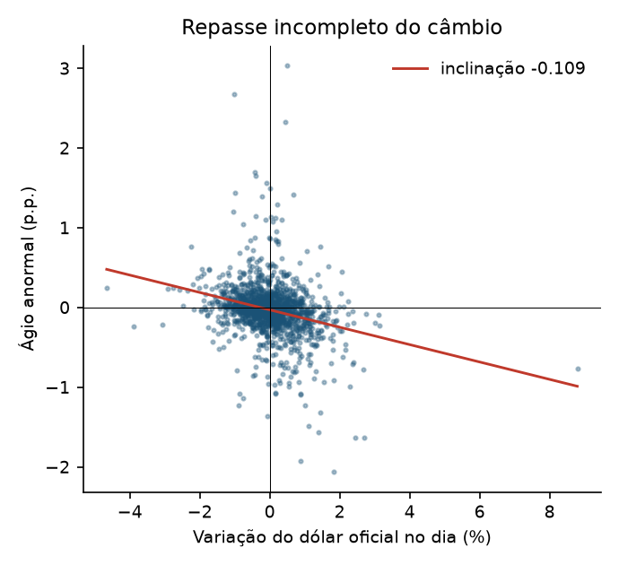
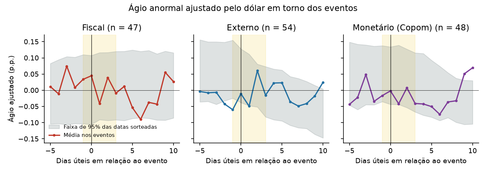
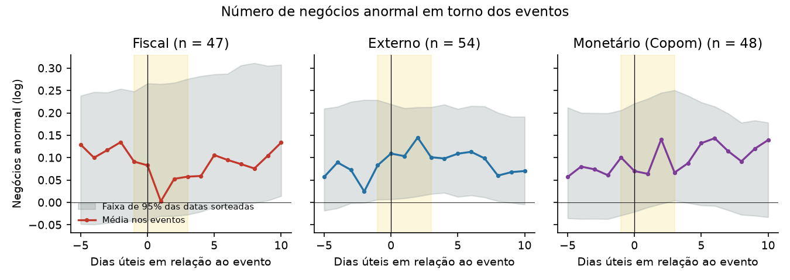
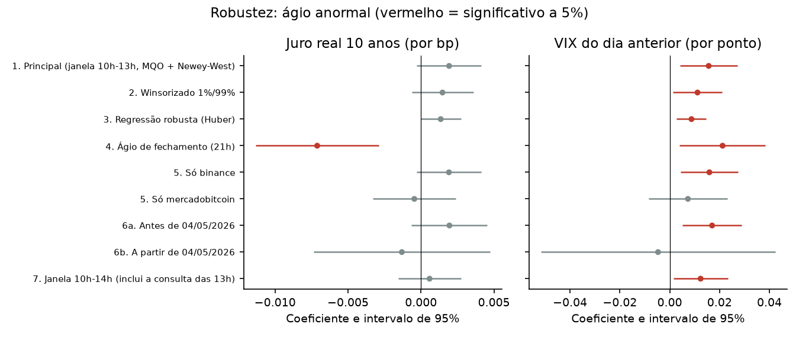

# Tabelas de resultados

*Gerado por `agio relatorio` em 01/11/2026. Não edite: rode o comando de novo. A interpretação está em `resultados.md`.*

## Regressões (MQO, erros de Newey-West com 5 defasagens)

### Ágio anormal (p.p.)

| variavel | coeficiente | erro_padrao | t | p_valor |
| --- | --- | --- | --- | --- |
| Intercept | -0.5229 | 0.2893 | -1.8074 | 0.0707 |
| d_dolar | -0.1290 | 0.0135 | -9.5886 | 0.0000 |
| d_juro_bp | 0.0019 | 0.0011 | 1.7084 | 0.0876 |
| d_vix | 0.0212 | 0.0107 | 1.9879 | 0.0468 |
| d_vix_ant | 0.0156 | 0.0059 | 2.6591 | 0.0078 |
| log_mercado | 0.0294 | 0.0172 | 1.7126 | 0.0868 |

### Número de negócios anormal (log)

| variavel | coeficiente | erro_padrao | t | p_valor |
| --- | --- | --- | --- | --- |
| Intercept | 3.5419 | 0.4853 | 7.2986 | 0.0000 |
| d_dolar | 0.0103 | 0.0133 | 0.7725 | 0.4398 |
| d_juro_bp | 0.0015 | 0.0014 | 1.0483 | 0.2945 |
| d_vix | 0.0076 | 0.0055 | 1.3829 | 0.1667 |
| d_vix_ant | 0.0075 | 0.0047 | 1.5858 | 0.1128 |
| log_mercado | -0.2056 | 0.0285 | -7.2089 | 0.0000 |

### Ticket médio anormal (log)

| variavel | coeficiente | erro_padrao | t | p_valor |
| --- | --- | --- | --- | --- |
| Intercept | -0.3357 | 0.1352 | -2.4831 | 0.0130 |
| d_dolar | -0.0119 | 0.0059 | -2.0103 | 0.0444 |
| d_juro_bp | 0.0004 | 0.0007 | 0.6139 | 0.5393 |
| d_vix | 0.0016 | 0.0028 | 0.5733 | 0.5664 |
| d_vix_ant | 0.0012 | 0.0023 | 0.5068 | 0.6123 |
| log_mercado | 0.0222 | 0.0082 | 2.7199 | 0.0065 |

### Repasse do câmbio (dólar no dia e 3 dias antes)

| variavel | coeficiente | erro_padrao | t | p_valor |
| --- | --- | --- | --- | --- |
| Intercept | -0.5142 | 0.2944 | -1.7462 | 0.0808 |
| d_dolar | -0.1257 | 0.0130 | -9.6991 | 0.0000 |
| d_dolar_l1 | -0.0573 | 0.0125 | -4.6042 | 0.0000 |
| d_dolar_l2 | -0.0245 | 0.0091 | -2.6832 | 0.0073 |
| d_dolar_l3 | 0.0020 | 0.0104 | 0.1955 | 0.8450 |
| d_juro_bp | 0.0015 | 0.0011 | 1.3661 | 0.1719 |
| d_vix | 0.0211 | 0.0109 | 1.9413 | 0.0522 |
| d_vix_ant | 0.0191 | 0.0059 | 3.2178 | 0.0013 |
| log_mercado | 0.0289 | 0.0175 | 1.6532 | 0.0983 |

Soma das defasagens:

| soma_defasagens | erro_padrao | p_valor |
| --- | --- | --- |
| -0.0798 | 0.0218 | 0.0003 |

## Estudo de evento (janela de −1 a +3 dias úteis)

### agio_anormal, lista completa

| tipo | n | car_medio | t | p_valor_t | p_valor_permutacao |
| --- | --- | --- | --- | --- | --- |
| externo | 53.000 | -0.202 | -1.147 | 0.256 | 0.498 |
| fiscal | 46.000 | -0.133 | -0.824 | 0.415 | 0.800 |
| monetario | 47.000 | -0.224 | -1.636 | 0.109 | 0.430 |
| politico | 4.000 | -0.105 | -0.204 | 0.852 | 0.966 |
| regulatorio | 4.000 | 0.204 | 0.418 | 0.704 | 0.509 |
| todos | 154.000 | -0.175 | -1.965 | 0.051 | 0.363 |
| agendado=nao | 13.000 | -0.006 | -0.013 | 0.990 | 0.778 |
| agendado=sim | 141.000 | -0.191 | -2.145 | 0.034 | 0.307 |

Domésticos x externos:

| car_domesticos | car_externos | diferenca | p_valor_permutacao |
| --- | --- | --- | --- |
| -0.131 | -0.202 | 0.072 | 0.766 |

### agio_ajustado_dolar, lista completa

| tipo | n | car_medio | t | p_valor_t | p_valor_permutacao |
| --- | --- | --- | --- | --- | --- |
| externo | 53.000 | -0.075 | -0.433 | 0.667 | 0.442 |
| fiscal | 46.000 | 0.056 | 0.372 | 0.712 | 0.979 |
| monetario | 47.000 | -0.093 | -0.679 | 0.500 | 0.396 |
| politico | 4.000 | -0.125 | -0.438 | 0.691 | 0.668 |
| regulatorio | 4.000 | 0.383 | 0.669 | 0.551 | 0.461 |
| todos | 154.000 | -0.031 | -0.354 | 0.724 | 0.384 |
| agendado=nao | 13.000 | 0.234 | 0.555 | 0.589 | 0.547 |
| agendado=sim | 141.000 | -0.055 | -0.635 | 0.526 | 0.276 |

Domésticos x externos:

| car_domesticos | car_externos | diferenca | p_valor_permutacao |
| --- | --- | --- | --- |
| 0.042 | -0.075 | 0.116 | 0.602 |

### negocios_anormal, lista completa

| tipo | n | car_medio | t | p_valor_t | p_valor_permutacao |
| --- | --- | --- | --- | --- | --- |
| externo | 53.000 | 0.542 | 2.131 | 0.038 | 0.899 |
| fiscal | 46.000 | 0.252 | 1.253 | 0.217 | 0.406 |
| monetario | 47.000 | 0.443 | 1.759 | 0.085 | 0.847 |
| politico | 4.000 | 0.977 | 2.048 | 0.133 | 0.655 |
| regulatorio | 4.000 | 0.132 | 0.352 | 0.748 | 0.720 |
| todos | 154.000 | 0.426 | 3.240 | 0.001 | 0.631 |
| agendado=nao | 13.000 | 0.861 | 2.075 | 0.060 | 0.531 |
| agendado=sim | 141.000 | 0.385 | 2.789 | 0.006 | 0.489 |

Domésticos x externos:

| car_domesticos | car_externos | diferenca | p_valor_permutacao |
| --- | --- | --- | --- |
| 0.310 | 0.542 | -0.232 | 0.490 |

### agio_anormal, sem eventos sobrepostos

| tipo | n | car_medio | t | p_valor_t | p_valor_permutacao |
| --- | --- | --- | --- | --- | --- |
| externo | 15.000 | -0.757 | -1.967 | 0.069 | 0.036 |
| fiscal | 30.000 | 0.005 | 0.025 | 0.980 | 0.562 |
| monetario | 15.000 | -0.342 | -1.406 | 0.182 | 0.420 |
| politico | 2.000 | -0.069 | -0.787 | 0.576 | 0.932 |
| todos | 62.000 | -0.265 | -1.752 | 0.085 | 0.299 |
| agendado=nao | 7.000 | -0.790 | -1.725 | 0.135 | 0.116 |
| agendado=sim | 55.000 | -0.199 | -1.244 | 0.219 | 0.593 |

Domésticos x externos:

| car_domesticos | car_externos | diferenca | p_valor_permutacao |
| --- | --- | --- | --- |
| 0.000 | -0.757 | 0.757 | 0.053 |

### agio_ajustado_dolar, sem eventos sobrepostos

| tipo | n | car_medio | t | p_valor_t | p_valor_permutacao |
| --- | --- | --- | --- | --- | --- |
| externo | 15.000 | -0.614 | -1.646 | 0.122 | 0.035 |
| fiscal | 30.000 | 0.218 | 1.132 | 0.267 | 0.347 |
| monetario | 15.000 | -0.163 | -0.670 | 0.514 | 0.502 |
| politico | 2.000 | -0.328 | -4.375 | 0.143 | 0.484 |
| todos | 62.000 | -0.093 | -0.636 | 0.527 | 0.407 |
| agendado=nao | 7.000 | -0.483 | -1.182 | 0.282 | 0.209 |
| agendado=sim | 55.000 | -0.043 | -0.278 | 0.782 | 0.655 |

Domésticos x externos:

| car_domesticos | car_externos | diferenca | p_valor_permutacao |
| --- | --- | --- | --- |
| 0.184 | -0.614 | 0.797 | 0.033 |

### negocios_anormal, sem eventos sobrepostos

| tipo | n | car_medio | t | p_valor_t | p_valor_permutacao |
| --- | --- | --- | --- | --- | --- |
| externo | 15.000 | 0.973 | 1.430 | 0.175 | 0.266 |
| fiscal | 30.000 | 0.491 | 1.883 | 0.070 | 0.870 |
| monetario | 15.000 | 0.680 | 1.127 | 0.279 | 0.627 |
| politico | 2.000 | 0.858 | 0.791 | 0.574 | 0.720 |
| todos | 62.000 | 0.665 | 2.654 | 0.010 | 0.353 |
| agendado=nao | 7.000 | 0.973 | 1.639 | 0.152 | 0.440 |
| agendado=sim | 55.000 | 0.626 | 2.289 | 0.026 | 0.453 |

Domésticos x externos:

| car_domesticos | car_externos | diferenca | p_valor_permutacao |
| --- | --- | --- | --- |
| 0.514 | 0.973 | -0.459 | 0.452 |

## Hipóteses do pré-registro (amostra de descoberta)

*V3 a V5 surgiram nesta amostra: aqui são exploratórias. A confirmação é na validação (`pre-registro.md`).*

| hipotese | descricao | estimativa | p_valor | sinal_previsto | p_holm | confirma |
| --- | --- | --- | --- | --- | --- | --- |
| V1 | Estresse fiscal eleva o ágio | juro 0.0019; dom−ext 0.072 | 0.7656 | True | 1.0000 | nao |
| V2 | Crises elevam a participação | CAR negócios 0.426 | 0.6310 | False | 1.0000 | nao |
| V3 | Medo global eleva o ágio | VIX anterior 0.0156 | 0.0078 | True | 0.0313 | sim |
| V4a | Repasse incompleto no dia | dólar -0.1290 | 0.0000 | True | 0.0000 | sim |
| V4b | Repasse se completa depois | soma defasagens -0.0798 | 0.0003 | False | 0.0013 | nao |
| V5 | Choques externos isolados reduzem o ágio | CAR externos -0.614 (n=15) | 0.0348 | True | 0.1044 | sim |

## Robustez (ágio anormal)

| especificacao | n | d_juro_bp_coef | d_juro_bp_p | d_vix_coef | d_vix_p | d_vix_ant_coef | d_vix_ant_p | d_dolar_coef | d_dolar_p |
| --- | --- | --- | --- | --- | --- | --- | --- | --- | --- |
| 1. Principal (janela 10h-13h, MQO + Newey-West) | 1490.0000 | 0.0019 | 0.0876 | 0.0212 | 0.0468 | 0.0156 | 0.0078 | -0.1290 | 0.0000 |
| 2. Winsorizado 1%/99% | 1490.0000 | 0.0015 | 0.1706 | 0.0113 | 0.0615 | 0.0111 | 0.0275 | -0.1214 | 0.0000 |
| 3. Regressão robusta (Huber) | 1490.0000 | 0.0014 | 0.0552 | 0.0072 | 0.0172 | 0.0087 | 0.0039 | -0.0977 | 0.0000 |
| 4. Ágio de fechamento (21h) | 1490.0000 | -0.0071 | 0.0010 | 0.1006 | 0.0000 | 0.0212 | 0.0158 | -0.0399 | 0.0822 |
| 5. Só binance | 1490.0000 | 0.0019 | 0.0893 | 0.0214 | 0.0463 | 0.0159 | 0.0071 | -0.1295 | 0.0000 |
| 5. Só mercadobitcoin | 884.0000 | -0.0005 | 0.7531 | 0.0139 | 0.3778 | 0.0073 | 0.3668 | -0.0908 | 0.0000 |
| 6a. Antes de 04/05/2026 | 1363.0000 | 0.0019 | 0.1415 | 0.0227 | 0.0402 | 0.0170 | 0.0047 | -0.1360 | 0.0000 |
| 6b. A partir de 04/05/2026 | 127.0000 | -0.0013 | 0.6705 | -0.0123 | 0.5975 | -0.0047 | 0.8454 | -0.0607 | 0.1107 |
| 7. Janela 10h-14h (inclui a consulta das 13h) | 1490.0000 | 0.0006 | 0.5903 | 0.0247 | 0.0066 | 0.0124 | 0.0266 | -0.1052 | 0.0000 |

## Lista de eventos

158 eventos em `dados/manual/eventos.csv` (regra em `decisoes.md`).

| tipo | agendado | n |
| --- | --- | --- |
| externo | nao | 6 |
| externo | sim | 49 |
| fiscal | nao | 5 |
| fiscal | sim | 42 |
| monetario | sim | 48 |
| politico | sim | 4 |
| regulatorio | nao | 2 |
| regulatorio | sim | 2 |

## Figuras

**01_serie_agio.png.** Ágio diário do USDT/BRL sobre a PTAX de venda: medida alinhada à janela da PTAX, medida de fechamento e mediana móvel (o 'normal' usado no ágio anormal).

**02_janela_vs_fechamento.png.** Cada ponto é um dia. Fora da diagonal estão os dias em que o horário de medição muda o ágio; os maiores desvios caem em dias de choque, o que motivou a medida alinhada.

**03_agio_por_corretora.png.** Ágio calculado separadamente em cada corretora. A Binance concentra o volume, por isso o indicador consolidado é, na prática, o da Binance.

**04_agio_anormal_eventos.png.** Ágio do dia menos a mediana dos 60 dias úteis anteriores. Linhas verticais: eventos não agendados da lista (anúncios fiscais, choques externos, normas do BC).

**05_dolar_e_agio.png.** Quando o dólar oficial sobe, o ágio cai: o USDT acompanha só parte do movimento no mesmo dia (efeito mecânico controlado em todas as regressões).

**06_trajetoria_agio.png.** Média diária em torno de cada tipo de evento (faixa amarela: janela do teste, −1 a +3) contra a faixa de 95% de datas sorteadas.

**07_trajetoria_negocios.png.** Participação em torno dos eventos contra datas sorteadas. A participação cresce com o mercado, por isso a comparação é com a faixa placebo, não com zero.

**08_robustez.png.** Mesma regressão em 9 especificações. O VIX do dia anterior é positivo e significativo em quase todas; o juro real não é positivo e significativo em nenhuma.

